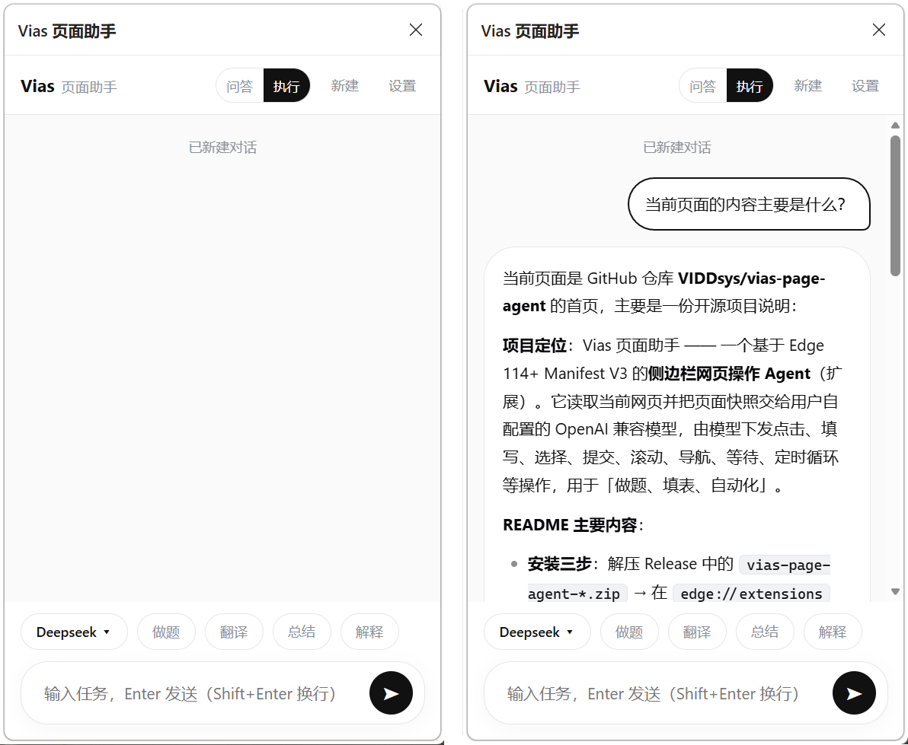

# Vias 页面助手



Edge 侧边栏网页操作 Agent（Manifest V3）。它读取当前页面，把页面快照交给你配置的 OpenAI 兼容模型，由模型执行点击、填写、选择、提交、滚动、导航等操作，可用于做题、填表、页面自动化。

## 安装

1. 从 [Release](https://github.com/VIDDsys/vias-page-agent/releases) 下载 zip，解压到一个固定目录（删除该目录扩展即失效）。
2. Edge 打开 `edge://extensions`，开启「开发人员模式」，点「加载解压缩的扩展」，选中解压出的文件夹。
3. 打开侧边栏，点右上角「设置」。首次使用已预置并选中「VIDDsys API」（地址 `https://api.viddsys.xyz/v1`，模型 `deepseek-v4.1-flash`），点击「填写密钥」，只填入自己的 API Key 后保存即可。也可点「添加模型」配置其它 OpenAI 兼容接口；已有配置会保留，预置提供商可编辑或删除。

在任意网页打开侧边栏：「执行」自动操作页面，「问答」只读不改页面。修改源码后需在扩展管理页点「重新加载」。

## 模型与隐私

- 支持任意 OpenAI Chat Completions 兼容接口；API Key 只存在本地 `chrome.storage.local`，不上云同步。
- 页面文字会发送给你配置的 API。模型配置中的「模型支持图片输入」只标记接口能力；图片默认不附带，模型可根据候选描述自主选择需要识别的图片，问答和执行均支持，不逐次询问或弹出授权。不会自动发送可见页面截图。
- 模型请求由侧边栏发起，规避 MV3 Service Worker 的 30 秒 fetch 限制。

## 工作机制

- **快照定位**：每次提取生成新的 `snapshotId`；同一文档内 ref 单调递增，避免续读后旧编号碰巧指向新目标。模型只能操作当前快照中已读分段的目标，同一快照继续读取不会让先前已读 ref 失效。页面跳转或目标身份变化时拒绝旧操作，无关页面更新不影响有效目标。支持原生控件、ARIA 控件、富文本、列表项和 open Shadow DOM；敏感字段依据类型、属性及关联标签脱敏。
- **长页面与上下文**：初次及操作后读取统一默认每段 32,000 个 UTF-16 代码单元，单次冻结窗口最多 512,000 个代码单元或 30,000 个节点；达到上限明确标记，模型可继续读取后续窗口。同一快照已读原文去重保留至 64,000 个代码单元，超预算或切换窗口前由模型提供最多 12,000 个代码单元的累计阅读摘要，并明确哪些原文已省略。读取和续读每个任务最多 80 次；页面变化会拒绝不可靠的续接。上述字符数不是模型 token 数，也不代表服务商的上下文额度。
- **按需图片**：先提供 `img`、`canvas` 及 open Shadow DOM 图片的编号、尺寸、描述和视口信息，不主动读取像素。模型每次可选 1–3 张，每个任务最多 8 次请求；优先读取已加载内容，必要时仅下载所选的 HTTP(S) 图片，跨域下载不附带登录凭据。图片有来源前后校验、数量、体积、像素与时间限制，失败会明确返回。图片只进入下一次模型请求，之后的历史只保留文字摘要。
- **操作幂等**：同一 `operationId` 只执行一次；`check` 不会反选已勾选项；`fill` 相同值不重复触发事件；`repeat` 禁止嵌套，可随时取消。
- **任务隔离**：每个任务独立 `runId`，停止即取消在途请求和页面等待；相同操作连续两轮无进展、连续三轮执行/通信失败或无效参数时自动停止，正常推进的任务最多 50 轮。
- **模型协议**：只接受最终回答，不执行推理草稿或截断输出；执行模式只有明确的 `done:true` 才判定任务完成。执行指令只接受整条回复唯一的完整 JSON 对象或唯一闭合 JSON 代码块；夹带说明、多个候选对象或疑似损坏的协议会要求模型有限重试，不执行、不直接显示或保存原文，避免把示例代码当成实际操作。合法填写值中的特殊字符保持原义；问答模式仍可正常展示 JSON 和代码示例。已失效的页面全文和图片不在后续请求中重复保留，操作历史使用有界摘要。
- **长输入与请求时限**：填写值在 200,000 个 UTF-16 代码单元内原样执行，超限明确拒绝整批操作，不静默截短；选择器最长 1,000 个代码单元。每次模型调用的总时限为 180 秒，网络重试与兼容重试共用剩余时间，后台另留 15 秒协调时间；快速失败最多普通重试两次，停止会取消在途请求。
- **执行模式**：所有操作自动执行、不弹确认，请只在自己负责的页面和账号上使用。

## 验证

以下命令在源码仓库执行。桌面分发副本不包含 `tests/`、`docs/` 或开发依赖，用于直接加载扩展。

```bash
npm run check
npm test
# 安装 package.json 中的开发依赖并使用系统 Edge：
npm run test:all
```

`test:all` 覆盖语法、模型协议与特殊字符、请求预算与取消、长页面分段、任务循环、按需图片与跨域下载、内容脚本、真实扩展加载、代理集成、敏感字段和侧栏/设置页的错误及并发反馈。浏览器测试使用临时隔离配置及本地假模型，不读取日常浏览器配置，不调用付费接口。

## 已知边界

- 浏览器内部页面、扩展商店不可读取；iframe 内部内容（包括同源 iframe）和 closed Shadow DOM 暂不可深入。快照会标记 iframe；未加载或虚拟化的内容仍需页面自身加载后再读取。
- 文件上传、拖拽暂不支持；部分网站只接受真实物理输入（`isTrusted=true` 无法伪造）。
- 原生 `confirm`/`alert` 弹窗需手动处理；自动化测试不能代替目标网站实测。
